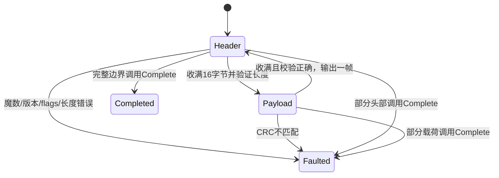

# 格式与状态机设计

## 帧格式

| 偏移 | 长度 | 字段 |
| --- | --- | --- |
| 0 | 2 | 魔数 `43 58` |
| 2 | 1 | 版本，目前必须为 1 |
| 3 | 1 | flags，目前必须为 0 |
| 4 | 4 | 小端无符号载荷长度 |
| 8 | 4 | 小端无符号序号 |
| 12 | 4 | 小端 CRC32C |
| 16 | N | 载荷 |

CRC32C 为 Castagnoli 多项式的 reflected 实现，初值和最终 xor 均为 `FFFFFFFF`。覆盖 `[0,12)` 的头部及全部载荷，不包含 CRC 字段本身。测试另用逐位算法和标准 `123456789` 向量验证。

## 交付与错误

`Feed` 不对协议错误抛异常。假如一段输入包含 `good + bad + good`，结果保留第一帧，`Consumed` 指向坏帧可判定错误的位置，最后一帧不被消费。实例进入永久错误状态；调用方应关闭或替换该流。这样不会因异常丢失同批次的前序成功消息，也不会误把载荷里的魔数当作恢复点。

`Complete` 是 EOF 通知。零字节流合法；部分头或部分载荷均返回 `TruncatedFrame`。正常完成后 `Feed` 返回 `DecoderClosed` 且消费 0 字节。空载荷在第16个头部字节到达时交付，不需要额外输入。

## 复杂度与边界

处理时间为 O(输入字节数)，解析器保留的未完成状态为 16 字节头部加不超过配置上限的载荷数组。每批输出列表还会持有该批全部成功帧，其大小取决于调用方单次传入的数据量；这不构成全连接级内存上限，真实适配层仍须限制读取批次和下游积压。

解析器是单使用者对象，不支持并行 `Feed`。每条连接应有自己的实例。校验正确只能说明数据未被该校验发现损坏；它不是身份或完整性认证机制。网络适配层还应提供 TLS、超时、取消、背压和业务级幂等。

采用有限错误状态而不自动恢复，牺牲损坏之后的消息可用性，换取清晰边界和可验证行为。未使用池化，避免为了减少分配而引入隐藏的生命周期和跨消息复用问题；后续优化应先以真实负载测量分配与吞吐。
